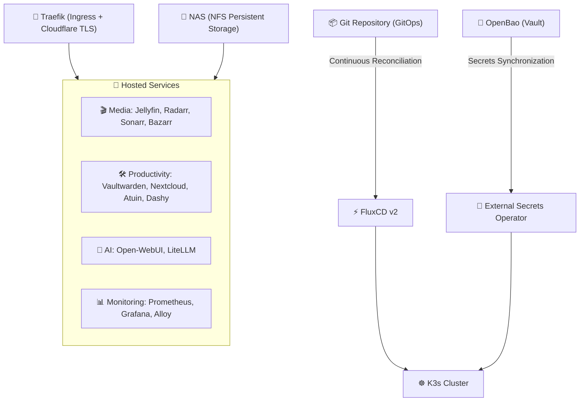

# ☸️ My Kubernetes Homelab (K3s + GitOps)

> Personal infrastructure managed via **GitOps**, designed as a hands-on learning playground for Cloud Native and DevOps technologies.

[](https://github.com/Rider128/Homelab-Kubernetes-Cluster/actions/workflows/ci.yaml)
[](https://fluxcd.io/)
[](https://external-secrets.io/)
[](https://openbao.org/)
[](https://nixos.org/)

---

## 🎯 About the Project

Welcome to my **Kubernetes homelab** repository!

* **Everything in Git (GitOps)**: No manual commands on the cluster under normal operations. The desired state is fully version-controlled here, and **FluxCD** continuously reconciles the cluster.
* **Zero-Secret Security**: No secrets or passwords are committed to Git (neither in plaintext nor base64). Credentials are stored in an **OpenBao** instance (open-source Vault) and dynamically injected into pods via **External Secrets Operator (ESO)**.
* **Reproducible Environment with Nix**: With [`flake.nix`](./flake.nix), all tooling (`kubectl`, `flux`, `kubeconform`, `gitleaks`) is pinned and instantly available with a single command (`nix develop`), keeping the host machine completely clean.
* **Continuous Integration (CI)**: On every commit, a pipeline validates Kubernetes manifests against strict OpenAPI schemas (`kubeconform`), checks for secret leaks (`gitleaks`), and enforces YAML linting standards.

---

## 🏛️ Architecture Overview



---

## 📂 Repository Layout

```text
.
├── apps/                 # Applications and business workloads
│   ├── media/            # Multimedia stack (Jellyfin, *arr)
│   ├── ia/               # LLM interfaces and proxies (Open-WebUI, LiteLLM)
│   ├── nextcloud/        # Personal cloud and file storage
│   ├── vaultwarden/      # Bitwarden-compatible password manager
│   ├── atuin/            # Encrypted shell history sync
│   └── dashy/            # Homelab startpage dashboard
│
├── infrastructure/       # Core cluster foundation
│   ├── traefik/          # Ingress controller & Let's Encrypt TLS certificates
│   ├── external-secrets/ # ESO operator & OpenBao vault connection
│   ├── monitoring/       # Prometheus, Grafana & Alloy observability stack
│   ├── storage/          # Storage classes & persistent NFS mounts
│   └── gitlab-runner/    # In-cluster runner for CI/CD automation
│
├── flux-system/          # FluxCD bootstrap and synchronization definitions
├── flake.nix             # Hermetic Nix environment (dev tools & CI checks)
└── .github/              # GitHub Actions CI pipeline (Nix Flake Check)
```

---

## 🛠️ Main Deployed Services

| Service | Role | Deployment Type |
|:---|:---|:---|
| **FluxCD v2** | GitOps engine & continuous reconciliation | Native manifests |
| **External Secrets** | Secure secret synchronization from OpenBao | HelmRelease |
| **Traefik v3** | Ingress Controller with automatic TLS (Cloudflare DNS-01) | HelmRelease |
| **Prometheus & Grafana** | System metrics, telemetry, and observability dashboards | Manifests & Helm |
| **Vaultwarden** | Self-hosted password vault | Native manifests |
| **Nextcloud** | Cloud storage and document collaboration | HelmRelease |
| **Jellyfin Stack** | Media streaming and collection automation | Native manifests |
| **LiteLLM / Open-WebUI** | Unified LLM gateway and Web UI | HelmRelease |
| **Atuin** | Encrypted shell history synchronization server | Native manifests |

---

## 💻 Local Testing & Validation

Thanks to Nix, there is no need to manually install the full Kubernetes toolchain.

```bash
# 1. Enter the isolated Nix devshell (loads kubectl, flux, kubeconform, gitleaks...)
nix develop

# 2. Run manifest schema validation and secret audit
nix flake check
```

---

## 👤 Author

- **Matthieu Daniel-Thomas** - Computer science student passionate about DevOps, Linux, and Cloud Native technologies.
- Private GitLab: [gitlab.innovalia.cc](https://gitlab.innovalia.cc)
- Public GitHub: [github.com/rider128](https://github.com/rider128)
